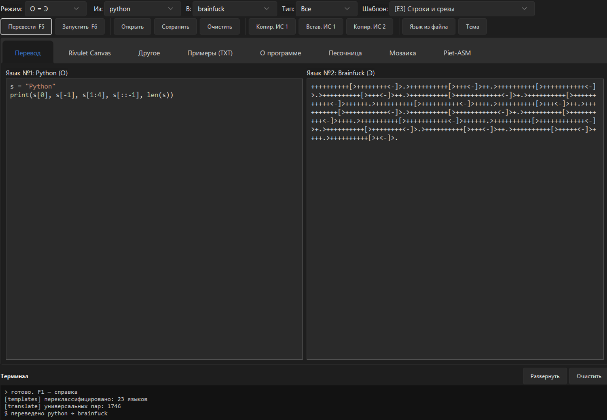
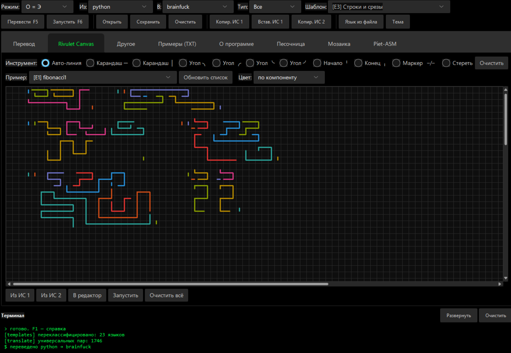
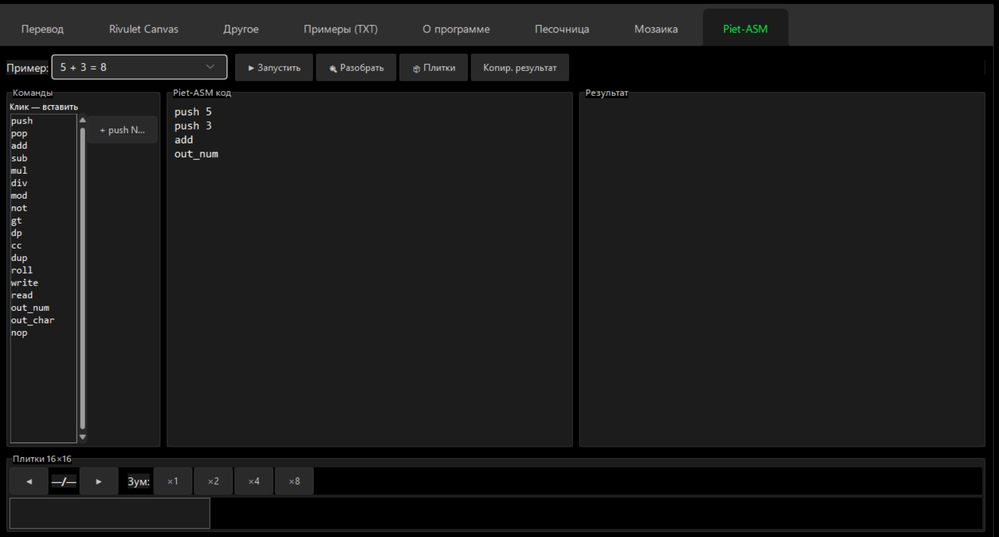
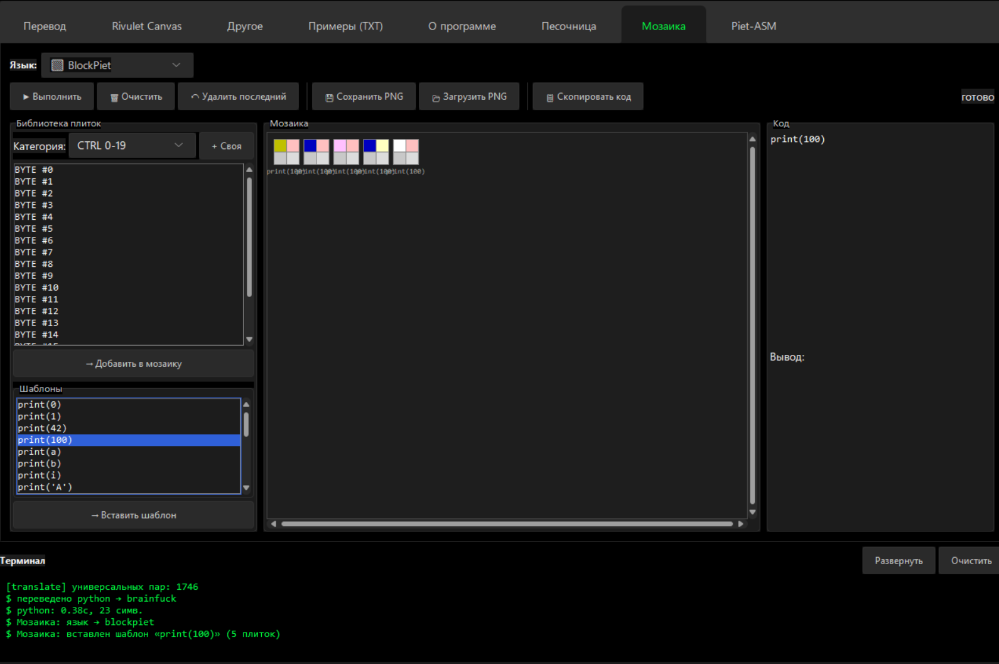
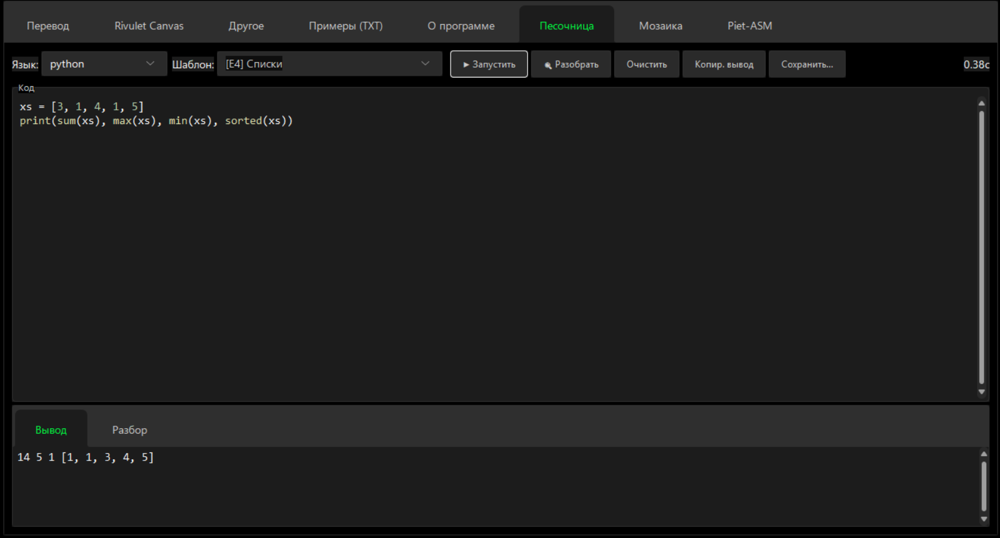
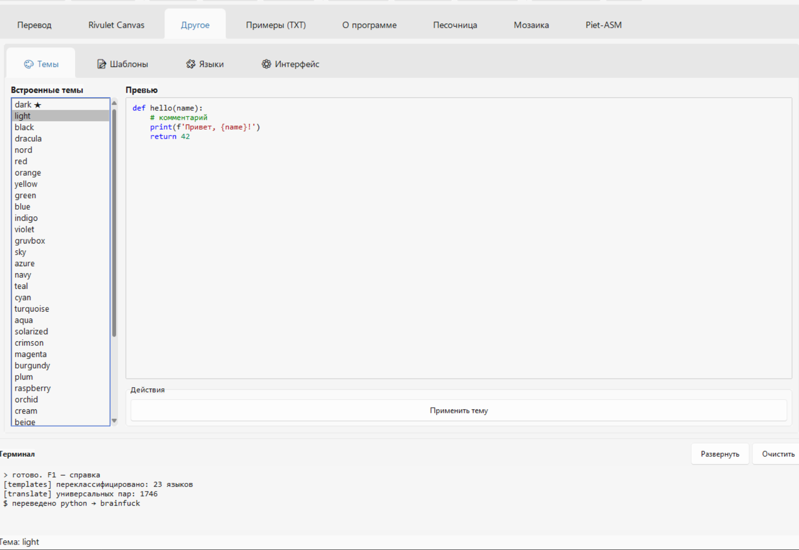

# Esolang Translator

**Многоязычная среда разработки для эзотерических и обычных языков программирования.**

43 языка · 1746 направлений перевода · 38 тем · 2D-редакторы Rivulet и Piet

[](https://github.com/SuperCat-0877/esolang-translator-app/releases)
[](https://opensource.org/licenses/MIT)
[](https://www.python.org/downloads/)

---

## 📸 Скриншоты

### Перевод между языками



*Python → Brainfuck. Выбираете языки, режим, шаблон — нажимаете F5.*

### Rivulet Canvas



*2D-редактор Rivulet с сеткой глифов и палитрой команд.*

### Piet-ASM



*Текстовый ассемблер Piet: `push`, `add`, `out_num` → компиляция в Piet.*

### Мозаика (BlockPiet)



*Плиточная визуализация кода: BYTE-плитки, шаблоны, визуальная сборка программ.*

### Песочница



*Изолированный запуск кода с таймаутом и вкладкой «Разбор».*

### 38 тем оформления



*От тёмных до светлых пастельных. Автоматическая глубина интерфейса.*

---

## ✨ Возможности

- **43 языка** — от обычных (Python, JavaScript, C++, Java, Go, Rust, Ruby, PHP, Kotlin, Swift, Scala, Julia, Dart, TypeScript, Elixir, F#, R, Perl, Lua, C#) до эзотерических (Brainfuck, Piet, Rivulet, Whitespace, Ook, Malbolge, Cow, Chicken, Shakespeare, LOLCODE, Befunge, Intercal, Unlambda, Deadfish, Pika, Thue, Hodor, ArnoldC).
- **1806 направлений перевода** между всеми парами языков.
- **4 режима перевода** — О=О, О=Э, Э=О, Э=Э.
- **38 тем** — 3 базовые, 5 классических, радуга, оттенки голубого / красного / фиолетового, 10 светлых пастельных.
- **2D-редакторы** — Rivulet Canvas и Piet Canvas с сеткой глифов.
- **Piet-ASM** — текстовый ассемблер Piet с плитками 16×16.
- **Мозаика** — плиточная визуализация кода (BlockPiet).
- **Песочница** — изолированный запуск кода с таймаутом.
- **Плагины** `.py` — загрузка без перезапуска приложения.
- **Шаблоны** — редактирование в UI, импорт/экспорт в `.txt`.
- **Переименование** языков, кнопок, пользовательские цвета списков.

---

## 🚀 Установка

### Готовый `.exe` (рекомендуется)

Скачайте `EsolangTranslator.exe` из раздела [**Releases**](../../releases).

1. Положите `.exe` в любую папку (например, `D:\Apps\EsolangTranslator\`)
2. Запустите

При первом запуске рядом появятся:
- `config.json` — настройки
- `plugins/` — пользовательские плагины
- `langs_disabled/` — отключённые языки

**Требования:**
- Windows 10 / 11 (64-bit)
- Ничего дополнительно ставить не нужно — Python и библиотеки внутри

**Для Windows 7 SP1 / 8:** требуется отдельная сборка под Python 3.8.10 (см. ниже).

Эта версия кода написана под Python 3.10+

### Из исходников

## 🙏 Благодарности

- [Daniel Temkin](https://github.com/danieltemkin) — оригинальный интерпретатор Rivulet
- [rdbende](https://github.com/rdbende) — Sun Valley ttk theme (`sv-ttk`)

---

## ⚠️ Важное примечание: BlockPiet и BrainPiet

В списке языков есть **BlockPiet** и **BrainPiet**, которые могут
ввести в заблуждение. Это **не самостоятельные языки** —
это **разновидности Piet** (и частично Brainfuck), адаптированные
для демонстрации разных подходов к визуальному программированию.

### BlockPiet

**Что это:** модификация Piet, где программа собирается из **плиток
(blocks)**, а не рисуется вручную.

**Чем отличается от Piet:**
- Плитки уже заданы — пользователь выбирает из библиотеки `BYTE #0`–`BYTE #14`
- Есть готовые шаблоны: `print(0)`, `print(1)`, `print(42)`, `print(100)`, `print(a)`, `print(b)` и т. д.
- Работает через вкладку **«Мозаика»** — визуальный конструктор
- Собирается на лету, без ручного рисования сетки

**Для чего:** обучение, быстрая визуализация базовых операций Piet,
демонстрация идеи «программа = набор плиток».

### BrainPiet

**Что это:** гибрид **Brainfuck и Piet** — где логика выражения
заимствована из Brainfuck, а визуализация — из Piet.

**Чем отличается:**
- Внутри — команды Brainfuck (`+`, `-`, `>`, `<`, `.`, `,`)
- Снаружи — визуальное представление через **2D-сетку глифов Piet**
- Промежуточный вариант: проще, чем чистый Piet, но визуальнее, чем обычный Brainfuck

**Для чего:** плавный переход от линейных языков (Brainfuck) к 2D-языкам
(Piet) — учебный мост.

### Что это значит для вас

- **Не ожидайте** от BlockPiet и BrainPiet полной совместимости
  с оригинальным Piet или Brainfuck.
- **Не путайте** их с оригинальными реализациями — эти языки
  созданы **внутри проекта** как учебные / демонстрационные.
- **Используйте** их как **дополнительные примеры** — они показывают,
  что эзотерические языки могут быть адаптированы под разные задачи.

### Настоящие Piet и Brainfuck

Оригинальные реализации тоже **присутствуют**:

| Язык | Что это |
|---|---|
| **Piet** | Полноценный Piet с холстом 16×16 и 20 цветами |
| **Piet-ASM** | Ассемблер Piet — текст → плитки |
| **Brainfuck** | Полная реализация классического Brainfuck |

Если хотите **чистый** Piet или Brainfuck — используйте **эти**
названия в списке языков, а не BlockPiet / BrainPiet.

## 💬 Обратная связь

**Почта:** [Kanadegameyalybly@gmail.com](mailto:Kanadegameyalybly@gmail.com)

Проект развивается как одиночная разработка, и **любое сообщение помогает
сделать его лучше**. Пишите — я читаю всё, даже если не отвечаю мгновенно.

---

### 🐛 Сообщить об ошибке

Что-то не работает, падает, выдаёт неправильный результат? Пришлите
описание — я исправлю в следующей версии. Особенно важно для:

- Переводов между редкими парами языков
- Rivulet / Piet — 2D-редакторов
- Песочницы и Piet-ASM
- Сборки `.exe` на вашей системе

### 💡 Предложить идею

Есть мысль, чего не хватает? Присылайте:

- **Новый язык** — эзотерический или обычный. Если знаете интересный — добавлю
- **Новую тему** — цветовая схема, тёмная / светлая / пастельная
- **Новый режим перевода** или комбинацию
- **Улучшение интерфейса** — что неудобно, где запутанно
- **Новую вкладку** или функцию

### 🔧 Попросить функцию

Если чего-то не хватает в текущей версии — скажите. Например:

- Экспорт в другой формат (не только `.txt`)
- Интеграция с внешним редактором
- Автосохранение при закрытии
- Поддержка конкретного языка или диалекта

### 🌐 Прислать свой плагин

Написали язык в `plugins/mylang.py`? Пришлите код — **добавлю в
коллекцию** и упомяну вас в благодарностях. Шаблон плагина — в разделе
[Плагины](#-плагины) выше.

### 📝 Исправить опечатки и перевод

Русский интерфейс, тексты в About, README — если нашли ошибку или
кривой перевод, пришлите. Такие мелочи видны только со стороны.

### 🤝 Сотрудничество

Хотите помочь с развитием проекта?

- **Тестирование** на другой ОС (Linux, macOS, Windows 7)
- **Сборка `.exe`** под Python 3.8.10 для Windows 7 SP1 / 8
- **Документация** — гайды, туториалы, статьи
- **Дизайн** — иконки, темы, скриншоты
- **Код** — если готовы прислать PR на GitHub

### 📜 Вопросы по лицензии

Использование в коммерческом проекте, форки, распространение в составе
другого продукта — если что-то неясно, спросите. MIT разрешает почти всё,
но иногда лучше уточнить.

### 🎓 Обучение и вопросы

Если вы **преподаёте эзотерические языки** или **учитесь сами** —
расскажите, как используете проект. Мне интересно, что помогает,
а что мешает. Обратная связь от преподавателей особенно ценна.

---

### 📋 Что указать в письме

Чтобы я мог быстро разобраться, в **первом письме** укажите:

| Пункт | Пример |
|---|---|
| **Версия** | `2.5.0` — видно во вкладке «О программе» (F1) |
| **ОС** | Windows 10 22H2 / Windows 11 / Linux Mint 21 |
| **Как запускаете** | `.exe` или `python Main.py` |
| **Что делали** | «Выбрал Python → Brainfuck, нажал F5» |
| **Что ожидали** | «Перевод появится справа» |
| **Что получили** | «Пустое поле, в терминале ошибка» |
| **Скриншот** | Если ошибка визуальная |
| **Лог** | `app.log` рядом с `.exe`, если был краш |

**Тема письма:** кратко — например, `[Bug] Rivulet не открывает .riv-файл`.

---

### 🕐 Сроки ответа

Отвечаю в течение **2–3 рабочих дней**. Баги исправляю в первую очередь,
фичи — по мере возможности. Если письмо потерялось — напишите повторно,
почта иногда глючит.

### 🔗 Альтернативы

Если предпочитаете GitHub:

- 🐛 [**Issues**](https://github.com/SuperCat-0877/esolang-translator-app/issues) — баги и идеи
- 💬 [**Discussions**](https://github.com/SuperCat-0877/esolang-translator-app/discussions) — общие вопросы (если включу)

**Но почта — быстрее.** Присылайте туда.
**© 2026 Esolang Translator**

```bash
git clone https://github.com/SuperCat-0877/esolang-translator-app.git
cd esolang-translator-app
pip install -r requirements.txt
python Main.py
